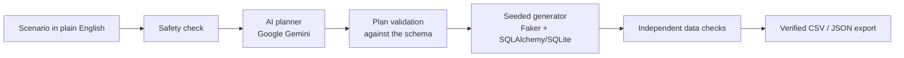

# QASeed

**Developer-first AI test data agent: plain English in, proven test data out.**

Describe the test data you need; QASeed plans it with AI, checks the plan against your schema, generates linked synthetic records and **proves** every requested condition with database checks before you download it.

> "Generate 12 subscription payments: 8 successful and 4 failed. Every failed invoice must remain unpaid."

A random data generator gives you rows. QASeed gives you the exact business conditions a test needs, with checks that show they are there.

## Try it

Start the app with `streamlit run app.py` (setup in [Run locally](#run-locally)), then take the 60-second tour:

1. In the sidebar, choose **Ready-made examples** (instant, no API calls).
2. Choose **D5-01** in *Ready-made examples* (12 payments: 8 succeeded, 4 failed) → **Plan scenario**.
3. Review the AI plan → **Generate & validate data** → every check passes and *requested = actual*.
4. **Download** the CSV files (ZIP) or the validation report (JSON).
5. Try **S16**: an invalid request is blocked with one clear line before any data is created.
6. Optional: switch to **Live AI** and type your own scenario (Gemini; 3 plans per session).

## Features

- **AI planning with guardrails:** Google Gemini turns plain English into a structured plan; personal data, secrets, SQL and prompt-injection text are refused before any API call.
- **Schema-checked plans:** every table, column, allowed value and count is validated against the real schema; impossible requests are blocked with a one-line reason.
- **Linked synthetic data:** customers → subscriptions → invoices → payments, created in dependency order with consistent IDs, dates and statuses (failed payments stay on unpaid invoices).
- **Proof, not promises:** independent SQL checks verify counts, requested conditions, foreign keys, uniqueness and business rules; results show *requested vs actual* for every count.
- **Verified export:** CSV files (one per table) + `validation_report.json` in a ZIP, and the report as its own JSON download. The files are reloaded into a fresh database and re-checked before they are offered.
- **Clear workflow:** Describe → Review AI plan → Generate & validate → Download, with a step tracker (done / active / blocked) and Reset.
- **Repeatable:** the same scenario, seed and date always produce the same data.

## How it works



1. **Safety check:** unsafe input is refused before any API call.
2. **AI planner:** Gemini returns a structured JSON plan (bounded retries on temporary API errors).
3. **Plan validation:** Python checks the plan against the schema; the AI never decides what the schema allows.
4. **Generation:** a seeded generator creates linked rows in dependency order.
5. **Data checks:** SQL checks prove every requested condition and rule.
6. **Export:** offered only when every check passed.

Sample schema: `customers → subscriptions → invoices → payments`. Synthetic data only.

## Run locally

Requires Python 3.11+ (3.12 recommended) and Git.

```bash
git clone <this repository's URL>
cd QASeed
git checkout feature/day5-ui-integration   # or main, once merged
python -m venv .venv
.venv\Scripts\activate                     # macOS/Linux: source .venv/bin/activate
python -m pip install -r requirements-dev.txt
python -m playwright install chromium      # headless browser for the UI tests
copy .env.example .env                     # macOS/Linux: cp .env.example .env
streamlit run app.py --server.address localhost
```

Open http://localhost:8501. For **Live AI**, add a free Gemini key (https://aistudio.google.com/apikey) to `.env`: `GEMINI_API_KEY=<your key>` and `GEMINI_MODEL=gemini-3.5-flash-lite`, then restart the app. Without a key, every ready-made example still works.

The app alone needs only `requirements.txt`; `requirements-dev.txt` adds pytest, pytest-html and Playwright.

## Testing

| Command | What it does |
|---|---|
| `python -m pytest -q` | All tests (offline, no API calls), including real-browser UI tests (Playwright + headless Chromium) |
| `python -m pytest -q -m "not browser"` | Same, without the browser tests (faster) |
| `python scripts/test_report.py` | Save the day's HTML test report to `reports/` |
| `python scripts/day5_ui_e2e.py` | Click through the app headless with the payment scenario and check the downloaded ZIP (offline) |
| `python scripts/day5_ui_e2e.py --live --confirm` | Same through live Gemini (1 request normally, at most 4) |
| `python -m qaseed.generator --all` | Requested vs generated vs verified for every valid offline scenario |
| `python -m qaseed.evaluate --set all` | 30-scenario evaluation with metrics (offline) |
| `python -m qaseed.planner "<scenario>"` | Plan one scenario with live Gemini |
| `python -m qaseed.llm_ping` | One live connectivity check |

Without a key, live commands print `status=SKIPPED` and make no API call. A skip is not a pass. "Mock" results use recorded AI replies to test QASeed's own logic; "live" results call the real model.

## Configuration

| Setting | Where | Default | Purpose |
|---|---|---|---|
| `GEMINI_API_KEY` | `.env` | – | Gemini key for Live AI (never committed; redacted from all output) |
| `GEMINI_MODEL` | `.env` | – | Model ID, e.g. `gemini-3.5-flash-lite` |
| `GEMINI_THINKING_LEVEL` | `.env` | model default | Optional: `minimal`, `low`, `medium` or `high` |
| `QASEED_DEFAULT_MODE` | `.env` | `live` if a key is set | `offline` starts in Ready-made examples mode |
| `QASEED_LIVE_PLANS_PER_SESSION` | `.env` | `3` | Live AI plans per session |
| `QASEED_LIVE_PLANS_PER_DAY` | `.env` | `40` | Live AI plans per day across all sessions |
| `QASEED_DB_PATH` | `.env` | `data/qaseed.db` | Local SQLite path for command-line runs |

## Progress

| Day | Focus | Status |
|---|---|---|
| 1 | Idea and scope | ✅ Completed |
| 2 | Environment, sample schema, schema viewer | ✅ Completed |
| 3 | AI planner + schema validation, 18-scenario baseline | ✅ Completed |
| 4 | Evaluation, error handling and retries, guardrails, prompt iteration | ✅ Completed |
| 5 | Streamlit end-to-end UI, data generation + checks, CSV/JSON export | ✅ Completed |
| 6 | Bounded repair, security review, bug fixes | ⏭️ Next phase |
| 7 | Deployment and hosted smoke tests | ⏭️ Next phase |
| 8 | Final submission and demo | ⏭️ Next phase |

## Results and test reports

| Day | Result | Evidence |
|---|---|---|
| 3 | 136 tests passing; live Gemini 15/18 (3 free-tier API errors, 0 wrong plans) | [evidence](docs/day3_evidence.md) · [test report](reports/day3/index.md) |
| 4 | 227 tests passing; 30-scenario evaluation 21/30 → 30/30 (mock); live Gemini 22/22; 0 unsafe requests accepted | [evidence](docs/day4_evidence.md) · [reports](reports/day4/index.md) |
| 5 | 375 tests passing (incl. 5 real-browser tests); live Gemini through the app: payment scenario → valid plan → 24/24 checks → verified CSV ZIP + JSON report; all 8 valid examples verified end to end in the UI | [evidence](docs/day5_evidence.md) · [reports](reports/day5/index.md) |

## Project layout

```text
app.py              Streamlit UI (calls qaseed.pipeline only)
qaseed/             pipeline (UI service layer), planner, validator, guardrails, LLM client,
                    generator, data checks, export, evaluation
tests/              one test file per module, browser tests, scenario fixtures
scripts/            daily test report, end-to-end UI check, Day 4 baseline
reports/            daily test reports and evaluation results
docs/               daily plans and evidence, manual test guide
data/               sample schema (generated .db files are gitignored)
assets/brand/       QASeed logo
.streamlit/         app theme (secrets are never stored here)
```

## Scope

| Output | Status |
|---|---|
| CSV files for customers, subscriptions, invoices, payments + `validation_report.json` (ZIP), and the JSON report on its own | ✅ MVP |
| SQL export (`INSERT` script for the generated dataset) | ⏭️ Planned post-MVP |
| Automatic repair of failed checks | ⏭️ Day 6 |

The Day 1 proposal listed SQL/CSV downloads; the MVP was narrowed to CSV (plus JSON) so the time went into a working end-to-end demo and verified data quality.

## Tech stack

Python · Streamlit · Google Gemini API · Pydantic · Faker · SQLAlchemy · SQLite · pytest + pytest-html · Playwright

## Safety

- Synthetic data only; no production connections. Generated emails use the reserved `example.com` domain.
- API keys live only in the local `.env` (gitignored) and are redacted from all output.
- Unsafe input (personal data, secrets, SQL, prompt injection) is refused before any API call.
- Logs record status, counts and timings only, never scenario text, generated data or keys.
- Live AI is capped per session and per day to protect the free tier.
